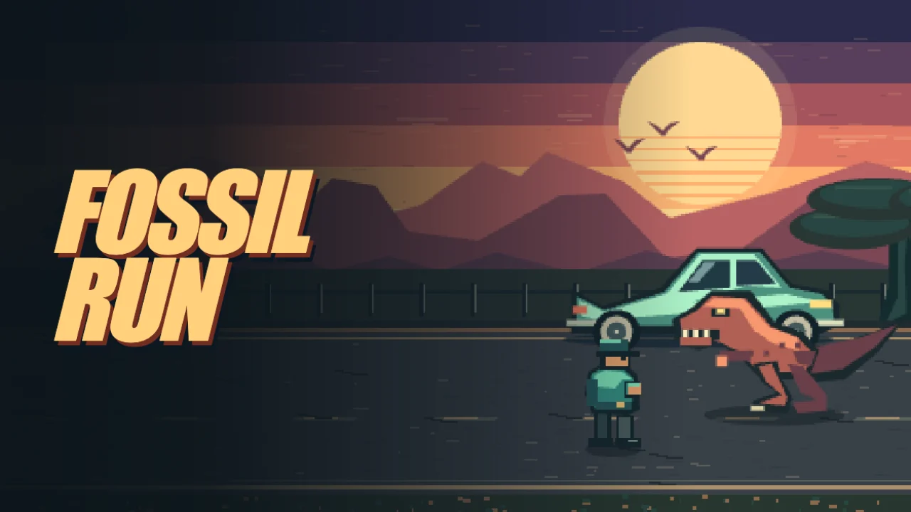

# Fossil Run

Fossil Run is a solo browser beat ’em up. Fight through three badlands sectors, defeat the Alpha Raptor, and reach the extraction car. The game uses original canvas art and synthesized sound. [Play on Smashi Arcade](https://smashi.app/games/cadillacs-and-dinosaurs/fossil-run-sol/)



## Run locally

From the repository root, start a static file server.

```sh
python3 -m http.server 8000 --bind 127.0.0.1
```

Open [the local game](http://127.0.0.1:8000/).

## Controls

| Action | Keyboard | Touch |
| --- | --- | --- |
| Move | WASD or arrow keys | Direction pad |
| Strike | J | Strike |
| Roll | K | Roll |
| Shockwave | L | Wave |
| Pause | Esc | Pause button |
| Start, resume, or retry | Enter | Start, Resume, or Play Again |

Hold Strike to chain attacks. Use Shockwave when the Wave meter is full. When the road is clear, head right to advance.
